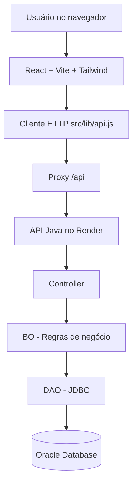

<div align="center">

# ♿ AcessoJá Web

### Acessibilidade começa com informação.

**Uma interface colaborativa para explorar, registrar e acompanhar informações sobre acessibilidade urbana.**


**Global Solution 2026.2 • Engenharia de Software • FIAP • CitizenTech**

[API em produção (Render)](https://acessoja-api.onrender.com) · [Repositório do backend](https://github.com/pedrofaleirosss/acessoja-api)

</div>

> **Sobre este repositório:** implementação **frontend** do AcessoJá em React. A API REST é um projeto separado, desenvolvido com Java 21, Spring Boot e JDBC, e utiliza Oracle Database para persistência.
>
> **Atenção:** esta é uma versão **acadêmica de demonstração**. A API ainda não possui login nem autorização de operações. Os formulários de edição e exclusão podem alterar dados reais do banco. Leia a seção [Segurança e limitações](#-segurança-e-limitações) antes de disponibilizar o endereço publicamente.

---

## 📚 Sumário

- [Sobre o AcessoJá](#-sobre-o-acessojá)
- [Objetivos do projeto](#-objetivos-do-projeto)
- [Funcionalidades e telas](#-funcionalidades-e-telas)
- [Entidades e operações da API](#-entidades-e-operações-da-api)
- [Tecnologias e decisões técnicas](#-tecnologias-e-decisões-técnicas)
- [Arquitetura e integração com o backend](#-arquitetura-e-integração-com-o-backend)
- [Estrutura de pastas](#-estrutura-de-pastas)
- [Pré-requisitos](#-pré-requisitos)
- [Instalação e execução local](#-instalação-e-execução-local)
- [Configuração da API e variáveis de ambiente](#-configuração-da-api-e-variáveis-de-ambiente)
- [Deploy na Vercel](#-deploy-na-vercel)
- [Outras opções de hospedagem](#-outras-opções-de-hospedagem)
- [Fluxos de demonstração](#-fluxos-de-demonstração)
- [Regras de negócio refletidas na interface](#-regras-de-negócio-refletidas-na-interface)
- [Tratamento de erros e comportamento da interface](#-tratamento-de-erros-e-comportamento-da-interface)
- [Segurança e limitações](#-segurança-e-limitações)
- [Solução de problemas](#-solução-de-problemas)
- [Melhorias futuras](#-melhorias-futuras)
- [Projeto acadêmico e links](#-projeto-acadêmico-e-links)

---

## 🌎 Sobre o AcessoJá

A mobilidade de pessoas com deficiência e mobilidade reduzida pode ser prejudicada tanto pela presença de **barreiras físicas** quanto pela **falta de informações confiáveis** sobre a acessibilidade dos espaços urbanos.

O **AcessoJá** propõe reunir informações colaborativas sobre locais, estabelecimentos e obstáculos, contribuindo para que cidadãos encontrem dados úteis antes de se deslocar e compartilhem experiências que ajudem outras pessoas.

A plataforma contempla, em seu domínio:

- **Estabelecimentos:** comércios e serviços com informações sobre acessibilidade;
- **Áreas acessíveis:** espaços públicos e suas características;
- **Barreiras urbanas:** obstáculos que dificultam a mobilidade;
- **Recursos de acessibilidade:** itens como rampas, elevadores e banheiros adaptados;
- **Avaliações:** notas e comentários da comunidade;
- **Validações:** confirmações e contestações de registros;
- **Relatos de resolução:** informações sobre barreiras corrigidas ou em análise.

O frontend deste repositório transforma os endpoints do backend Java em uma interface **responsiva**, com telas de consulta, contribuição e gerenciamento de dados. A proposta visual utiliza azul-marinho, turquesa, cartões informativos, indicadores de situação e navegação adaptada a diferentes tamanhos de tela.

### Público-alvo

Pessoas com deficiência, pessoas idosas, cidadãos com mobilidade reduzida, acompanhantes, cuidadores e demais pessoas interessadas em compartilhar ou consultar informações sobre acessibilidade urbana.

### Escopo desta entrega

O foco é demonstrar uma **integração ponta a ponta** entre React, uma API RESTful Spring Boot e Oracle Database. Não se trata, nesta versão, de uma plataforma pública pronta para operar com usuários reais.

---

## 🎯 Objetivos do projeto

- Disponibilizar uma interface para consultar informações de acessibilidade cadastradas no Oracle;
- Permitir a demonstração dos métodos HTTP `GET`, `POST`, `PUT` e `DELETE`;
- Centralizar o gerenciamento das **12 entidades** implementadas no backend;
- Facilitar a contribuição com novos estabelecimentos, áreas, barreiras, avaliações e validações;
- Exibir as situações de moderação, resolução e análise;
- Tratar respostas e erros da API de maneira compreensível;
- Oferecer navegação responsiva em computadores, tablets e smartphones;
- Documentar as particularidades e limitações do MVP para avaliações acadêmicas e evoluções futuras.

---

## 🖥️ Funcionalidades e telas

### 1. Visão geral (*Dashboard*)

Painel inicial com **indicadores derivados dos dados consultados na API**, como quantidades de estabelecimentos, áreas acessíveis, barreiras e cidades, além de informações de situação e contribuições recentes. Os indicadores são calculados no frontend a partir dos registros carregados; não existe um serviço separado de analytics no backend.

### 2. Explorar locais

- Alternância entre **estabelecimentos**, **áreas acessíveis** e **barreiras urbanas**;
- Pesquisa textual por título, descrição, endereço e outros campos relevantes;
- Filtro por cidade, relacionado às informações de bairro;
- Exibição em cartões com endereço, descrição e situação do registro;
- Visualização de detalhes por meio de uma consulta `GET` individual;
- Carregamento sob demanda de informações relacionadas, incluindo avaliações, validações, relatos e recursos de acessibilidade;
- Opção específica de demonstração para incluir registros ainda não aprovados.

**Nota técnica:** os filtros de pesquisa e cidade são aplicados **no React**, sobre as listas já carregadas. A aplicação não afirma oferecer busca geográfica por GPS, rotas ou mapas interativos.

### 3. Contribuir

Área que reúne atalhos para cadastrar:

- Um novo estabelecimento;
- Uma nova área acessível;
- Uma barreira urbana;
- Uma avaliação de estabelecimento;
- Uma confirmação ou contestação de registro;
- Um relato de resolução de barreira.

Os formulários seguem os campos previstos no backend. Como ainda não há login, a pessoa que demonstra a aplicação precisa selecionar ou informar um **ID de usuário existente**, quando exigido pela operação.

### 4. Gerenciar dados

Painel de demonstração com acesso a **todas as 12 entidades**, incluindo:

- Listagem e consulta de registros;
- Pesquisa nos dados exibidos;
- Paginação local (oito registros por página);
- Formulários de cadastro e edição;
- Visualização de detalhes;
- Exclusão mediante confirmação;
- Atualização dos dados após operações bem-sucedidas;
- Análise de relatos de resolução pendentes.

Em telas maiores, os dados aparecem em tabelas; em dispositivos menores, são apresentados em cartões adaptados à largura disponível.

### 5. Sobre o projeto

Apresentação da proposta CitizenTech, da arquitetura tecnológica, dos links do backend e dos cuidados necessários para evoluir o MVP.

### Recursos compartilhados da interface

- Navegação lateral e menu adaptado para celular;
- Modais para cadastro, edição, detalhes e confirmação;
- Mensagens temporárias de sucesso ou erro;
- Estados de carregamento, erro e lista vazia;
- Campos obrigatórios, validações simples e seletores de referências disponíveis;
- Indicadores visuais para situações como `PENDENTE`, `APROVADO`, `ATIVA` e `RESOLVIDA`;
- Estilos de foco visível e opção de reduzir animações conforme as preferências do dispositivo.

Esses cuidados de interface **não constituem uma certificação de conformidade com WCAG**.

---

## 🗃️ Entidades e operações da API

O frontend utiliza os seguintes módulos definidos em `src/data/modules.js`:

| Entidade / módulo | Endpoint base | Operações disponíveis no painel |
|---|---|---|
| Cidades | `/cidades` | GET, POST, PUT, DELETE |
| Bairros | `/bairros` | GET, POST, PUT, DELETE |
| Usuários | `/usuarios` | GET, POST, PUT, DELETE |
| Registros gerais | `/registros` | GET, POST, PUT, DELETE |
| Estabelecimentos | `/estabelecimentos` | GET, POST, PUT, DELETE |
| Áreas acessíveis | `/areas-acessiveis` | GET, POST, PUT, DELETE |
| Barreiras urbanas | `/barreiras` | GET, POST, PUT, DELETE |
| Recursos de acessibilidade | `/recursos-acessibilidade` | GET, POST, PUT, DELETE |
| Estabelecimento–recurso | `/estabelecimentos-recursos` | GET, POST, PUT, DELETE |
| Avaliações | `/avaliacoes` | GET, POST, PUT, DELETE |
| Validações | `/validacoes` | GET, POST, PUT, DELETE |
| Relatos de resolução | `/relatos-resolucao` | GET, POST, PUT, DELETE |

O frontend também utiliza o endpoint específico:

```http
PUT /relatos-resolucao/{id}/analisar
```

Esse endpoint permite aprovar ou rejeitar relatos pendentes e atualizar a situação da barreira correspondente, conforme as regras do backend.

### Padrão de requisições

| Operação | Exemplo | Objetivo |
|---|---|---|
| `GET` | `/barreiras` | Listar barreiras |
| `GET` | `/barreiras/11` | Consultar uma barreira específica |
| `POST` | `/barreiras` | Cadastrar uma nova barreira |
| `PUT` | `/barreiras/11` | Atualizar uma barreira existente |
| `DELETE` | `/barreiras/11` | Excluir uma barreira, quando permitido pelas relações do banco |

A tabela de associação **estabelecimento–recurso** utiliza **chave composta**, portanto a consulta, alteração e exclusão individuais utilizam dois identificadores:

```http
GET    /estabelecimentos-recursos/{idEstabelecimento}/{idRecurso}
PUT    /estabelecimentos-recursos/{idEstabelecimento}/{idRecurso}
DELETE /estabelecimentos-recursos/{idEstabelecimento}/{idRecurso}
```

> **Atenção:** os IDs de exemplo são ilustrativos. Não execute operações de alteração ou exclusão contra dados importantes de um banco compartilhado.

---

## 🧰 Tecnologias e decisões técnicas

| Tecnologia | Versão declarada no projeto | Responsabilidade |
|---|---|---|
| React | 19 | Interface declarativa e componentes |
| React DOM | 19 | Renderização no navegador |
| JavaScript | ES Modules | Linguagem da aplicação |
| Vite | 6 | Servidor de desenvolvimento e build |
| Tailwind CSS | 4 | Estilização utilitária |
| `@tailwindcss/vite` | 4 | Integração Tailwind/Vite |
| Lucide React | 0.468.x | Ícones da interface |
| Fetch API | Nativa do navegador | Requisições HTTP |
| Node.js | 20.19+; recomendado Node 22 | Ambiente de desenvolvimento e build |
| npm | Compatível com a versão Node instalada | Instalação de dependências |
| Vercel | Hospedagem estática com reescrita de `/api` | Deploy do frontend |

**Backend consumido (repositório separado):** Java 21, Spring Boot 4.1.2, JDBC e Oracle Database.

### Por que React + Vite?

- React favorece a reutilização de componentes visuais;
- Vite oferece um projeto frontend enxuto, com inicialização rápida;
- Tailwind facilita a construção responsiva;
- O proxy permite consumir a API hospedada no Render sem exigir um servidor Node próprio para o frontend;
- A separação frontend/backend preserva a arquitetura REST desenvolvida na disciplina.

A aplicação é uma **Single-Page Application (SPA)**. A navegação entre seções é controlada pelo estado de `App.jsx`; esta versão **não usa React Router**.

---

## 🔄 Arquitetura e integração com o backend



### Como funciona uma operação

1. O usuário acessa uma tela e realiza uma ação, por exemplo, cadastrar uma barreira;
2. O React monta os campos do formulário com base nas definições do módulo;
3. `apiRequest()` envia uma requisição HTTP em JSON para `/api/barreiras`;
4. O proxy encaminha a requisição para `https://acessoja-api.onrender.com/barreiras`;
5. O controller Spring Boot recebe os dados e chama a camada BO;
6. A BO valida as regras e encaminha o processamento ao DAO;
7. O DAO executa as instruções SQL no Oracle;
8. A resposta volta ao frontend, que informa sucesso ou erro e atualiza a listagem.

### Organização das requisições

O arquivo `src/lib/api.js` centraliza:

- URL-base da comunicação;
- Serialização de corpos JSON;
- Leitura de respostas;
- Tratamento dos códigos HTTP;
- Mensagens amigáveis para erros conhecidos;
- Tempo limite de **90 segundos** por requisição;
- Identificação da rota de registro individual, inclusive no caso de chave composta.

O `App.jsx` gerencia as consultas, o cache temporário em memória, estados de carregamento e atualização de dados após inserções, alterações e exclusões. As operações que carregam informações relacionadas são organizadas para reduzir requisições simultâneas.

---

## 📂 Estrutura de pastas

```text
acessoja-web/
├── public/
│   ├── _redirects                 # Proxy e fallback SPA para Netlify
│   └── favicon.svg               # Ícone da aplicação
├── src/
│   ├── components/
│   │   ├── Contribute.jsx        # Atalhos de contribuição
│   │   ├── Dashboard.jsx         # Indicadores e visão geral
│   │   ├── EntityForm.jsx        # Formulário reutilizável
│   │   ├── EntityManager.jsx     # Painel CRUD das entidades
│   │   ├── Explore.jsx           # Busca, filtros e cartões de locais
│   │   └── Ui.jsx                # Componentes visuais compartilhados
│   ├── data/
│   │   └── modules.js            # Configuração dos 12 módulos e campos
│   ├── lib/
│   │   └── api.js                # Cliente HTTP e erros da API
│   ├── App.jsx                   # Navegação, estados e operações
│   ├── main.jsx                  # Inicialização do React
│   └── styles.css                # Tailwind, tipografia e estilos globais
├── .env.example                  # Exemplo opcional de variável de API
├── .gitignore                    # Arquivos ignorados pelo Git
├── .nvmrc                        # Versão principal recomendada do Node
├── index.html                    # Entrada HTML da aplicação
├── package.json                  # Dependências e scripts
├── vercel.json                   # Reescrita /api para o Render
└── vite.config.js                # Plugins Vite e proxy local
```

### Arquivos principais

**`src/data/modules.js`** — catálogo das entidades, rótulos, campos, tipos, opções, referências entre entidades, colunas e caminhos dos endpoints. O mesmo conjunto de definições é reutilizado pelos formulários e pelo painel de gerenciamento.

**`src/components/EntityForm.jsx`** — constrói formulários de forma dinâmica, verifica campos obrigatórios e limites de tamanho, permite selecionar referências já carregadas e monta o corpo JSON das operações.

**`src/components/EntityManager.jsx`** — apresenta as 12 entidades com listagem, pesquisa, paginação, detalhes e ações CRUD.

**`src/components/Explore.jsx`** — apresenta os registros de acessibilidade com busca textual e filtro por cidade.

**`src/App.jsx`** — coordena navegação, abertura de modais, requisições, feedback e atualização dos dados.

---

## ✅ Pré-requisitos

Para executar **somente o frontend**, é necessário:

- **Node.js 20.19 ou superior**, preferencialmente Node 22;
- **npm**;
- Um editor, como VS Code;
- Conexão com a internet para baixar as dependências e consultar a API;
- API do AcessoJá disponível no Render, com conexão ao Oracle operacional.

**Não é necessário instalar o Java, IntelliJ ou Oracle localmente para executar este frontend**, porque ele consulta o backend já hospedado. Esses componentes seriam necessários para executar ou desenvolver o backend separadamente.

Confira as versões disponíveis:

```bash
node --version
npm --version
```

---

## 💻 Instalação e execução local

### 1. Obtenha o código

Se você já clonou o repositório do frontend, acesse a pasta correspondente. Se estiver utilizando o ZIP disponibilizado para esta entrega, extraia-o e abra a pasta `acessoja-web` no VS Code.

```bash
cd acessoja-web
```

### 2. Instale as dependências

```bash
npm install
```

### 3. Inicie o servidor de desenvolvimento

```bash
npm run dev
```

O Vite mostrará o endereço local, normalmente:

```text
http://localhost:5173
```

Abra esse endereço no navegador. As informações serão solicitadas à API do Render por meio do proxy de desenvolvimento configurado no Vite.

### 4. Gere o build de produção

```bash
npm run build
```

Os arquivos estáticos de produção serão gerados na pasta `dist/`.

### 5. Pré-visualize o build (com ressalva)

```bash
npm run preview
```

**Importante:** `npm run preview` disponibiliza os arquivos estáticos, mas **não oferece o mesmo proxy de desenvolvimento configurado em `server.proxy`**. Portanto, as chamadas para `/api` só funcionarão nesse modo se houver um proxy de servidor configurado, ou se o backend permitir acesso direto via CORS e `VITE_API_BASE_URL` apontar para ele.

Para testar a integração completa localmente, prefira `npm run dev`. Para validar o build com o proxy de produção, utilize o deploy na Vercel.

### Scripts disponíveis

| Comando | Descrição |
|---|---|
| `npm install` | Instala as dependências |
| `npm run dev` | Inicia o servidor Vite para desenvolvimento |
| `npm run build` | Produz os arquivos para deploy em `dist/` |
| `npm run preview` | Pré-visualiza o build estático |

O projeto fornecido **não inclui scripts de testes automatizados ou lint**; a verificação funcional deve ser feita por navegação e requisições de teste controladas.

---

## 🔌 Configuração da API e variáveis de ambiente

### API utilizada

```text
https://acessoja-api.onrender.com
```

O comportamento padrão do frontend é realizar requisições para o caminho **relativo** `/api`.

Por exemplo:

```text
No React:    GET /api/cidades
No backend:  GET https://acessoja-api.onrender.com/cidades
```

### Desenvolvimento local

O proxy está declarado em `vite.config.js`:

```js
server: {
  proxy: {
    '/api': {
      target: 'https://acessoja-api.onrender.com',
      changeOrigin: true,
      secure: true,
      rewrite: (path) => path.replace(/^\/api/, ''),
    },
  },
}
```

Assim, **não é necessário configurar CORS no backend para o desenvolvimento com `npm run dev`**.

### Produção na Vercel

O projeto já contém `vercel.json`:

```json
{
  "rewrites": [
    {
      "source": "/api/:path*",
      "destination": "https://acessoja-api.onrender.com/:path*"
    }
  ]
}
```

A reescrita faz com que o navegador utilize o domínio do frontend para `/api`, e a Vercel encaminhe a requisição ao Render. Isso **não adiciona autenticação ao backend**.

### `VITE_API_BASE_URL` (opcional)

O arquivo `.env.example` documenta a variável opcional:

```dotenv
# Utilize somente quando não for possível usar proxy e a API permitir CORS.
VITE_API_BASE_URL=https://sua-api.exemplo.com
```

Por padrão, **não defina essa variável na Vercel**: o projeto já utiliza `/api` com reescrita e não precisa dela.

Se você configurar `VITE_API_BASE_URL` com um domínio externo, o navegador tentará acessá-lo diretamente; nesse cenário, a API precisará permitir a origem do frontend por **CORS**. As variáveis `VITE_` são inseridas no bundle do cliente e **não devem conter segredos**.

**`DB_USUARIO` e `DB_SENHA` são variáveis do backend Java, não do frontend.** Não as configure no Vite nem publique credenciais Oracle no GitHub ou na Vercel como variáveis `VITE_`.

---

## ▲ Deploy na Vercel

O projeto já está preparado para hospedagem do frontend na Vercel.

### 1. Envie o frontend ao GitHub

Crie um repositório separado do backend. Uma sugestão de nome é **`acessoja-web`** ou **`acessoja-frontend`**.

Na pasta do frontend, caso ainda não esteja versionada:

```bash
git init
git add .
git commit -m "feat: implement AcessoJa web frontend"
git branch -M main
git remote add origin https://github.com/SEU-USUARIO/SEU-REPOSITORIO.git
git push -u origin main
```

Substitua `SEU-USUARIO/SEU-REPOSITORIO` pelo endereço real do novo repositório. Se ele já tiver sido inicializado, não repita `git init` nem `git remote add origin`.

### 2. Importe o repositório

1. Entre em [vercel.com](https://vercel.com/);
2. Clique em **Add New → Project**;
3. Selecione o repositório GitHub do frontend;
4. Confirme o diretório raiz do projeto: a pasta que contém `package.json` e `vercel.json`;
5. Confira as configurações de build.

### 3. Configure o build

| Configuração | Valor |
|---|---|
| Framework Preset | `Vite` |
| Root Directory | Pasta que contém o `package.json` |
| Build Command | `npm run build` |
| Output Directory | `dist` |
| Install Command | `npm install` |
| Node.js | Preferencialmente Node 22 |
| Environment Variables | Nenhuma obrigatória no frontend |

Se o repositório contiver a pasta `acessoja-web` como subdiretório, selecione-a em **Root Directory**. Se o próprio repositório já abrir nos arquivos do frontend, use a raiz padrão.

### 4. Publique a aplicação

Clique em **Deploy**. A Vercel instalará as dependências, executará o build e disponibilizará uma URL do frontend.

O arquivo `vercel.json` deve permanecer na raiz do projeto. Ele encaminha as requisições de `/api/*` ao Render.

### 5. Valide a publicação

Após o deploy:

1. Abra a URL gerada pela Vercel;
2. Verifique se o dashboard carrega;
3. Acesse **Explorar locais** e alterne entre as categorias;
4. Abra **Gerenciar dados → Cidades** para testar uma consulta;
5. Abra as ferramentas de desenvolvedor do navegador e confira a aba **Network**;
6. A requisição `/api/cidades` deve retornar dados em JSON, se o backend estiver disponível;
7. Teste a experiência em largura de celular e computador.

**Recomendação:** antes de expor a aplicação a visitantes, avalie as limitações de segurança descritas abaixo. O deploy público de um painel CRUD sem autenticação permite alterações não autorizadas no banco.

---

## ☁️ Outras opções de hospedagem

### Netlify

A pasta `public/` contém o arquivo `_redirects`:

```text
/api/*  https://acessoja-api.onrender.com/:splat  200
/*      /index.html                             200
```

Configuração de build: `npm run build`. Diretório publicado: `dist`.

### Outros provedores

Configure a hospedagem para:

1. Servir o conteúdo estático de `dist/`;
2. Encaminhar `/api/*` para `https://acessoja-api.onrender.com/*`;
3. Preservar os métodos HTTP (GET, POST, PUT e DELETE) e o corpo JSON;
4. Oferecer fallback para `index.html`, caso sejam adotadas rotas client-side no futuro.

Se o provedor não oferecer reescrita/proxy, será necessário configurar **CORS no backend Spring Boot** e definir a URL direta da API no build do frontend.

---

## 🧪 Fluxos de demonstração

Para uma apresentação acadêmica, recomendamos utilizar **dados fictícios e registros descartáveis**. Comece com operações de consulta, que não modificam o banco.

### Cenário A — Explorar informações existentes (somente leitura)

1. Acesse **Visão geral** e observe os indicadores;
2. Entre em **Explorar locais**;
3. Selecione **Estabelecimentos**, **Áreas acessíveis** ou **Barreiras**;
4. Pesquise por nome ou endereço e, se houver dados, filtre por cidade;
5. Abra os detalhes de um registro;
6. Utilize **Carregar relações** quando disponível para visualizar avaliações, recursos ou relatos associados.

### Cenário B — Demonstrar um CRUD (altera dados)

1. Abra **Gerenciar dados → Cidades**;
2. Consulte a listagem;
3. Cadastre **uma cidade fictícia com ID ainda não utilizado**;
4. Verifique a atualização da tabela;
5. Edite o registro de demonstração;
6. Exclua apenas o registro criado para esse teste, caso não possua dependências.

Não utilize registros que pertençam a outras pessoas ou que estejam vinculados a dados importantes.

### Cenário C — Demonstrar uma contribuição (altera dados)

1. Abra **Contribuir → Registrar barreira**;
2. Escolha um usuário e um bairro previamente cadastrados;
3. Informe um ID de registro disponível;
4. Preencha título, descrição, endereço e tipo de barreira;
5. Salve e confira a resposta da API;
6. Verifique a barreira em **Gerenciar dados**.

**Importante:** novos registros recebem moderação `PENDENTE`. Como a API atual não possui fluxo completo de aprovação de registros, a barreira pode **não aparecer na exploração padrão**, que prioriza registros aprovados. Existe a opção visual de incluir não aprovados apenas para a demonstração.

### Cenário D — Avaliações, validações e resolução

O painel também oferece operações para:

- Avaliar um estabelecimento com nota de 1 a 5;
- Confirmar ou contestar um registro **aprovado**, respeitando a autoria;
- Informar a resolução de uma barreira **aprovada e ativa**;
- Analisar um relato **pendente**, informando o ID de um usuário administrador ativo.

Esses passos dependem de registros previamente preparados e das regras do backend. **Não há login real** que vincule uma ação à identidade do visitante.

---

## 📋 Regras de negócio refletidas na interface

### Identificadores manuais

Os métodos `POST` do backend atual exigem identificadores numéricos. A interface **sugere** um ID com base nos registros carregados, mas essa sugestão não garante exclusividade em acessos simultâneos. Em caso de conflito, escolha um ID válido e ainda não utilizado.

### Especialização de registros

Estabelecimentos, áreas e barreiras possuem dados comuns da tabela `REGISTRO` e dados específicos de cada entidade. Os formulários especializados fazem as chamadas corretas ao backend.

**Não utilize o cadastro genérico de `REGISTRO` como substituto dos cadastros especializados:** ele não cria automaticamente a linha correspondente em `ESTABELECIMENTO`, `AREA_ACESSIVEL` ou `BARREIRA`.

### Moderação

Novos registros são cadastrados com `statusModeracao = PENDENTE`. O frontend apenas **exibe** esse estado e fornece a opção de incluir registros não aprovados na listagem de demonstração. Ele **não implementa uma moderação administrativa geral** de novos locais.

### Avaliações

- Nota de **1 a 5**;
- Comentário conforme os limites do banco;
- Um usuário só pode ter uma avaliação por estabelecimento, devido à restrição de unicidade.

### Validações

- Tipos `CONFIRMA` e `CONTESTA`;
- Somente registros aprovados podem receber novas validações;
- O autor não pode validar o próprio registro;
- Uma contestação exige justificativa;
- A combinação usuário/registro deve ser única.

### Relatos de resolução

- Somente barreiras aprovadas e `ATIVA` podem receber novos relatos;
- Um novo relato recebe `statusAnalise = PENDENTE`;
- A barreira passa para `RESOLUCAO_INFORMADA` ao receber o relato;
- Aprovação do relato pode alterar a barreira para `RESOLVIDA`;
- Rejeição pode retornar a barreira para `ATIVA`;
- A análise utiliza um ID de administrador ativo, **sem autenticar quem está realizando a ação**.

### Exclusões e integridade

O Oracle pode recusar a exclusão quando existir uma chave estrangeira dependente. A interface exibe a mensagem recebida em vez de ignorar a restrição. **Não é realizado apagamento em cascata arbitrário pelo frontend**.

---

## 💬 Tratamento de erros e comportamento da interface

O cliente HTTP transforma respostas de erro em mensagens que podem ser exibidas ao usuário.

| Situação | Comportamento esperado |
|---|---|
| Carregamento | Exibe indicador enquanto aguarda dados |
| Lista vazia | Exibe estado vazio com orientação |
| Sucesso no cadastro/edição | Exibe confirmação e recarrega dados afetados |
| Exclusão | Solicita confirmação antes da requisição |
| `400 Bad Request` | Informa dados inválidos |
| `403 Forbidden` | Informa ausência de permissão, se retornado pela API |
| `404 Not Found` | Indica registro inexistente |
| `409 Conflict` | Indica conflito ou restrição de integridade |
| `500 Internal Server Error` | Informa falha no servidor ou Oracle |
| `502/503` | Informa indisponibilidade temporária |
| Tempo limite / falha de rede | Apresenta mensagem orientando a verificar API e proxy |

### Inicialização do serviço no Render

Se a hospedagem do backend suspender a instância por inatividade, a primeira consulta pode levar mais tempo. O frontend permite até **90 segundos** por requisição antes de interromper a espera e apresentar um erro.

### Cache de dados

O frontend mantém um cache **temporário em memória** para reduzir consultas repetidas durante a navegação. Após operações de gravação, solicita novamente os dados relacionados ao módulo. Esse mecanismo não substitui sincronização multiusuário nem cache persistente.

---

## 🔐 Segurança e limitações

> **A API atual não possui autenticação e autorização efetivas.** O formulário de usuário e o campo de ID do administrador não equivalem a uma sessão autenticada. Consequentemente, não é seguro disponibilizar publicamente operações de alteração ou exclusão em um banco de dados que contenha informações importantes.

Cuidados necessários:

- **Use apenas dados fictícios** para demonstrações;
- **Não cadastre senhas pessoais**, dados sensíveis ou informações reais de terceiros;
- Evite divulgar a URL pública do painel de administração sem restringir o acesso à API no backend;
- Faça cópias de segurança dos dados de teste que precisar preservar;
- Nunca coloque credenciais Oracle ou tokens privados no código React;
- Lembre-se de que **proxy/CORS não são mecanismos de autenticação**;
- Não assuma que ocultar um botão no frontend impede requisições diretas à API.

Outras limitações da versão apresentada:

- Sem login, sessão, JWT ou permissões por usuário;
- Sem moderação geral de estabelecimentos, áreas e barreiras;
- IDs definidos manualmente;
- Busca e filtros realizados no cliente após o carregamento dos dados;
- Sem geolocalização, mapa interativo ou cálculo de rotas;
- Sem testes automatizados incluídos no projeto entregue;
- Sem garantia de atualização em tempo real entre usuários diferentes;
- Dependência da disponibilidade do Render e da conexão com Oracle.

Para transformar o MVP em uma plataforma pública, o controle de acesso deve ser implementado **principalmente no servidor**, e não apenas na interface.

---

## 🛠️ Solução de problemas

### `npm` ou `node` não é reconhecido

Instale uma versão compatível do Node.js e reabra o terminal. Verifique com `node --version` e `npm --version`.

### Erro de dependência ou build na Vercel

Confira o `Root Directory`, a presença de `package.json`, o comando `npm run build`, a saída `dist` e a versão do Node. Faça um build local para identificar erros antes de publicar.

### O dashboard abre, mas os dados não carregam

Verifique se `https://acessoja-api.onrender.com/cidades` está acessível, se o serviço Render está ativo e se o banco Oracle responde. Consulte também **Network** e **Console** no navegador.

### `404` em `/api/cidades` na Vercel

Confirme que `vercel.json` está na raiz efetiva do projeto publicado e que a reescrita de `/api/:path*` foi incluída no deploy. Teste `/api/cidades` no próprio domínio do frontend.

### Erro de CORS

Se estiver usando o proxy padrão `/api`, a comunicação deve acontecer pelo mesmo domínio do frontend. Caso tenha definido `VITE_API_BASE_URL` diretamente para o Render, remova a variável ou configure CORS para a origem correta no backend.

### `409 Conflict` ao cadastrar ou excluir

Pode indicar um ID já utilizado, uma combinação única duplicada ou uma chave estrangeira impedindo a operação. Verifique os relacionamentos e utilize registros fictícios válidos.

### Novo registro não aparece na lista de exploração

Verifique `statusModeracao`: os novos registros ficam `PENDENTE`. Para visualizar dados não aprovados na demonstração, utilize a opção de inclusão disponível na tela Explorar.

### Não consigo avaliar, validar ou informar resolução

Essas funcionalidades dependem das regras do backend: estabelecimento existente, registro aprovado, usuário diferente do autor, barreira ativa e ausência de duplicidade, conforme o caso. Consulte a mensagem exibida pelo formulário.

---

## 🚀 Melhorias futuras

- Autenticação real com login e autorização por papéis;
- Moderação administrativa dos registros;
- Geração automática de identificadores no Oracle;
- Pesquisas paginadas e filtros executados no backend;
- Integração com mapas, geolocalização e indicação de rotas acessíveis;
- Upload e armazenamento seguro de imagens;
- Testes automatizados de componentes e integração;
- Monitoramento de disponibilidade e erros;
- Revisão completa de acessibilidade baseada em WCAG;
- Proteções adicionais de privacidade, auditoria e segurança;
- Evolução do design para uma plataforma pronta para uso público.

---

## 🎓 Projeto acadêmico e links

O AcessoJá foi desenvolvido no contexto da **Global Solution 2026.2 — CitizenTech**, no curso de **Engenharia de Software da FIAP**.

O frontend demonstra a integração de uma interface responsiva com a API RESTful elaborada em Java, aplicando conceitos de comunicação HTTP, organização de componentes, formulários, estados de interface, persistência e regras de negócio.

| Recurso | Link |
|---|---|
| Backend — código-fonte | [github.com/pedrofaleirosss/acessoja-api](https://github.com/pedrofaleirosss/acessoja-api) |
| Backend — Render | [acessoja-api.onrender.com](https://acessoja-api.onrender.com) |
| Frontend — Vercel | Adicionar o endereço após publicar |
| Frontend — GitHub | Adicionar o endereço do repositório após criar |

> **Licença:** este repositório não inclui um arquivo de licença. Caso o projeto seja aberto a contribuições ou reutilização por terceiros, recomenda-se definir uma licença apropriada.

---

<div align="center">

### ♿ AcessoJá

**Acessibilidade começa com informação.**

*Tecnologia e colaboração para cidades mais acessíveis.*

</div>
