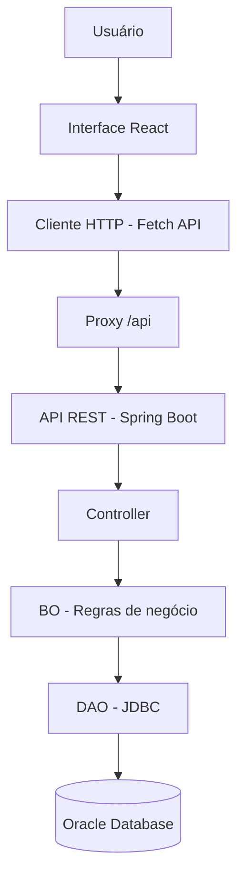

<div align="center">

# ♿ AcessoJá Web

### Acessibilidade começa com informação.

**Uma plataforma colaborativa para consultar, registrar e compartilhar informações sobre acessibilidade urbana.**


**Global Solution 2026.2 · Engenharia de Software · FIAP · CitizenTech**

[🌐 Acessar a aplicação](https://acessoja-web.vercel.app/) · [⚙️ API REST](https://acessoja-api.onrender.com) · [💻 Repositório do backend](https://github.com/pedrofaleirosss/acessoja-api)

</div>

---

## 📚 Sumário

- [Sobre o AcessoJá](#-sobre-o-acessojá)
- [Objetivos do projeto](#-objetivos-do-projeto)
- [Funcionalidades e telas](#-funcionalidades-e-telas)
- [Tecnologias utilizadas](#-tecnologias-utilizadas)
- [Arquitetura e integração](#-arquitetura-e-integração)
- [Entidades e operações da API](#-entidades-e-operações-da-api)
- [Organização do código](#-organização-do-código)
- [Como executar localmente](#-como-executar-localmente)
- [Limitações e melhorias futuras](#-limitações-e-melhorias-futuras)
- [Contexto acadêmico e links](#-contexto-acadêmico-e-links)

---

## 🌎 Sobre o AcessoJá

A acessibilidade urbana não depende apenas da existência de rampas, elevadores e estruturas adaptadas. **Ter acesso a informações confiáveis sobre os lugares também faz diferença na autonomia e na mobilidade das pessoas.**

O **AcessoJá** nasceu da proposta de reunir, em um único ambiente, informações compartilhadas pela comunidade sobre estabelecimentos, áreas públicas e barreiras urbanas. A plataforma busca facilitar a consulta das condições de acessibilidade de um local e incentivar a participação dos cidadãos na atualização dessas informações.

Por exemplo, antes de visitar um estabelecimento, uma pessoa pode consultar os recursos de acessibilidade cadastrados. Ao identificar uma calçada danificada, um cidadão pode registrar a barreira para que outras pessoas tenham conhecimento do obstáculo.

**Este repositório contém o frontend do AcessoJá**, desenvolvido em React. O backend é uma API RESTful independente, construída com Java, Spring Boot, JDBC e Oracle Database.

### Público-alvo

Pessoas com deficiência, pessoas idosas, cidadãos com mobilidade reduzida, familiares, cuidadores e qualquer pessoa interessada em contribuir para espaços urbanos mais acessíveis.

## 🎯 Objetivos do projeto

- Facilitar a consulta de informações sobre acessibilidade urbana;
- Reunir estabelecimentos, áreas acessíveis e barreiras em uma interface organizada;
- Incentivar contribuições da comunidade por meio de cadastros, avaliações e validações;
- Permitir o acompanhamento de relatos de resolução de barreiras;
- Demonstrar a integração entre frontend React, API Spring Boot e banco de dados Oracle;
- Oferecer uma experiência responsiva em computadores, tablets e celulares.

---

## 🖥️ Funcionalidades e telas

A interface está dividida em cinco áreas principais.

### 1. Dashboard

A página inicial apresenta indicadores calculados a partir dos dados retornados pela API, incluindo quantidades de estabelecimentos, áreas acessíveis, barreiras e cidades cadastradas. Também exibe informações sobre registros e contribuições recentes.

### 2. Explorar locais

Permite navegar entre **estabelecimentos**, **áreas acessíveis** e **barreiras urbanas**. A tela oferece:

- Pesquisa por informações como título, descrição e endereço;
- Filtro por cidade;
- Cartões com os principais dados dos registros;
- Visualização de detalhes e informações relacionadas;
- Consulta a avaliações, recursos de acessibilidade, validações e relatos, quando aplicável.

Os filtros são aplicados no próprio React, sobre os dados carregados da API. A listagem prioriza os registros aprovados e possui uma opção para incluir outros registros durante a demonstração.

### 3. Contribuir

Reúne formulários para participação da comunidade, incluindo:

- Cadastro de estabelecimentos e áreas acessíveis;
- Registro de barreiras urbanas;
- Avaliação de estabelecimentos;
- Confirmação ou contestação de informações;
- Envio de relatos sobre resolução de barreiras.

Os dados informados são enviados à API e passam pelas validações implementadas no backend.

### 4. Gerenciar dados

Painel de demonstração das operações **GET, POST, PUT e DELETE** das 12 entidades utilizadas pelo sistema.

Possui listagens, pesquisa, paginação, formulários de cadastro e edição, visualização de detalhes e confirmação antes de exclusões. Também permite acionar a análise de relatos de resolução pendentes.

> **Observação:** essa área foi criada para demonstrar os recursos da API no contexto acadêmico. Como o backend ainda não tem autenticação, as operações utilizam dados reais do banco e não devem ser tratadas como um painel administrativo seguro para produção.

### 5. Sobre o projeto

Apresenta a proposta do AcessoJá, seu contexto CitizenTech e as principais tecnologias que fazem parte da solução.

### Experiência de uso

A interface inclui navegação adaptável a dispositivos móveis, estados de carregamento, mensagens de sucesso e erro, indicadores de situação dos registros, formulários reutilizáveis e confirmação antes de operações destrutivas.

---

## 🛠️ Tecnologias utilizadas

| Tecnologia                  | Utilização                                          |
| --------------------------- | --------------------------------------------------- |
| **React 19**                | Construção da interface e gerenciamento dos estados |
| **JavaScript (ES Modules)** | Lógica da aplicação                                 |
| **Vite 6**                  | Ambiente de desenvolvimento e geração do build      |
| **Tailwind CSS 4**          | Estilização e layout responsivo                     |
| **Lucide React**            | Ícones da interface                                 |
| **Fetch API**               | Comunicação HTTP com o backend                      |
| **Vercel**                  | Hospedagem da aplicação web                         |

**Backend integrado:** Java 21, Spring Boot 4.1.2, JDBC e Oracle Database, com hospedagem no Render.

O frontend foi construído como uma **Single-Page Application (SPA)**. As telas são organizadas por componentes React, e a navegação entre seções é controlada pela aplicação, sem uso do React Router nesta versão.

---

## 🔄 Arquitetura e integração

O AcessoJá separa o frontend do backend, permitindo que a interface web consuma os recursos disponibilizados pela API Java.



### Como funciona uma operação

Ao cadastrar uma barreira, por exemplo, o usuário preenche o formulário no React. A interface envia uma requisição `POST` para a API, que recebe os dados no Controller, executa as validações na camada BO e realiza a persistência no Oracle por meio do DAO. Em seguida, a resposta é apresentada na interface e os dados são atualizados.

A comunicação é centralizada em `src/lib/api.js`, responsável por enviar requisições, interpretar respostas HTTP e apresentar mensagens de erro. As chamadas utilizam a rota `/api`, encaminhada ao backend hospedado no Render por meio de um proxy.

---

## 🗃️ Entidades e operações da API

O painel de gerenciamento permite interagir com as **12 entidades do modelo relacional**:

| Módulo                        | Endpoint base                |
| ----------------------------- | ---------------------------- |
| Cidades                       | `/cidades`                   |
| Bairros                       | `/bairros`                   |
| Usuários                      | `/usuarios`                  |
| Registros                     | `/registros`                 |
| Estabelecimentos              | `/estabelecimentos`          |
| Áreas acessíveis              | `/areas-acessiveis`          |
| Barreiras urbanas             | `/barreiras`                 |
| Recursos de acessibilidade    | `/recursos-acessibilidade`   |
| Recursos dos estabelecimentos | `/estabelecimentos-recursos` |
| Avaliações                    | `/avaliacoes`                |
| Validações                    | `/validacoes`                |
| Relatos de resolução          | `/relatos-resolucao`         |

Os módulos oferecem operações de listagem, consulta individual, cadastro, atualização e exclusão, respeitando as regras de negócio e as restrições do Oracle.

O sistema também utiliza consultas especializadas, como avaliações por estabelecimento, validações por registro e relatos por barreira. Para análise de relatos, utiliza a operação `PUT /relatos-resolucao/{id}/analisar`.

Alguns exemplos de regras aplicadas pelo backend:

- Avaliações recebem notas de **1 a 5**;
- Um usuário não pode validar o próprio registro;
- Contestações exigem justificativa;
- Novos registros são cadastrados com moderação `PENDENTE`;
- Relatos de resolução alteram a situação da barreira conforme o resultado da análise;
- Restrições de integridade do Oracle impedem determinadas operações inconsistentes.

A documentação e o código da API estão no [repositório acessoja-api](https://github.com/pedrofaleirosss/acessoja-api).

---

## 📂 Organização do código

```text
acessoja-web/
├── public/                  # Arquivos públicos
├── src/
│   ├── components/          # Telas, formulários e componentes reutilizáveis
│   │   ├── Contribute.jsx
│   │   ├── Dashboard.jsx
│   │   ├── EntityForm.jsx
│   │   ├── EntityManager.jsx
│   │   ├── Explore.jsx
│   │   └── Ui.jsx
│   ├── data/
│   │   └── modules.js       # Definição das entidades e campos
│   ├── lib/
│   │   └── api.js           # Comunicação com a API REST
│   ├── App.jsx              # Navegação e estados da aplicação
│   ├── main.jsx             # Inicialização do React
│   └── styles.css           # Estilos globais e Tailwind
├── index.html
├── package.json
├── vercel.json               # Configuração de rotas da aplicação
└── vite.config.js
```

A definição dos formulários e das entidades é centralizada em `src/data/modules.js`, permitindo reutilizar a mesma configuração em diferentes operações do painel.

---

## 💻 Como executar localmente

Para explorar o código na própria máquina, utilize **Node.js 20.19+** e npm. Após clonar o repositório:

```bash
npm install
npm run dev
```

Acesse o endereço indicado pelo Vite, geralmente `http://localhost:5173`.

O frontend consome o backend já hospedado no Render, portanto **não é necessário instalar Java ou Oracle localmente** para utilizar a interface.

---

## 🔐 Limitações e melhorias futuras

O AcessoJá é um **MVP acadêmico**, desenvolvido para demonstrar a integração entre interface, API RESTful e banco de dados. Ele não deve ser considerado uma plataforma pública pronta para operar com informações sensíveis.

### Limitações atuais

- A API ainda não possui login e autorização de operações;
- A moderação administrativa geral dos registros não está implementada;
- Os IDs são informados ou sugeridos manualmente, sem geração automática pelo banco;
- Os filtros são executados no frontend após o carregamento dos registros;
- Não há mapas interativos, geolocalização ou cálculo de rotas;
- Não há sincronização em tempo real nem uma suíte de testes automatizados no frontend.

> **Importante:** o painel de gerenciamento pode modificar ou excluir dados reais do Oracle. Para demonstrações, utilize apenas informações fictícias e não cadastre senhas pessoais ou dados sensíveis. As permissões deverão ser implementadas no backend antes de qualquer utilização pública com usuários reais.

### Próximas evoluções

- Autenticação e autorização por perfis;
- Fluxo de aprovação e rejeição de novos registros;
- Identificadores gerados automaticamente;
- Busca e paginação no backend;
- Integração com mapas e recursos de geolocalização;
- Upload de imagens dos locais;
- Testes automatizados e melhorias contínuas de acessibilidade.

---

## 🎓 Contexto acadêmico e links

O AcessoJá foi desenvolvido para a **Global Solution 2026.2 — CitizenTech**, no curso de **Engenharia de Software da FIAP**.

O projeto reúne conceitos de desenvolvimento de interfaces responsivas, consumo de APIs REST, orientação a objetos, arquitetura em camadas, banco de dados relacional e colaboração digital aplicada à acessibilidade urbana.

| Recurso               | Link                                                                                       |
| --------------------- | ------------------------------------------------------------------------------------------ |
| **Aplicação web**     | [acessoja-web.vercel.app](https://acessoja-web.vercel.app/)                                |
| **Frontend — GitHub** | [github.com/pedrofaleirosss/acessoja-web](https://github.com/pedrofaleirosss/acessoja-web) |
| **Backend — GitHub**  | [github.com/pedrofaleirosss/acessoja-api](https://github.com/pedrofaleirosss/acessoja-api) |
| **API — Render**      | [acessoja-api.onrender.com](https://acessoja-api.onrender.com)                             |

---

<div align="center">

### ♿ AcessoJá

**Acessibilidade começa com informação.**

_Tecnologia e colaboração para cidades mais acessíveis._

</div>
